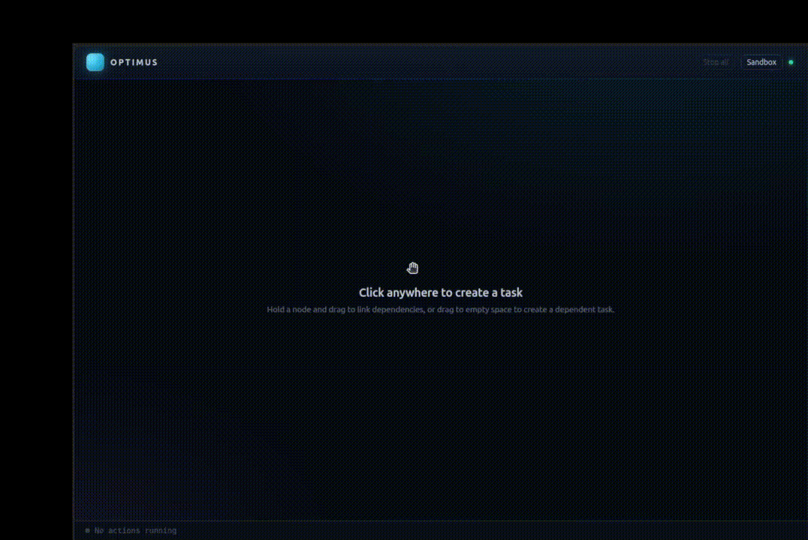
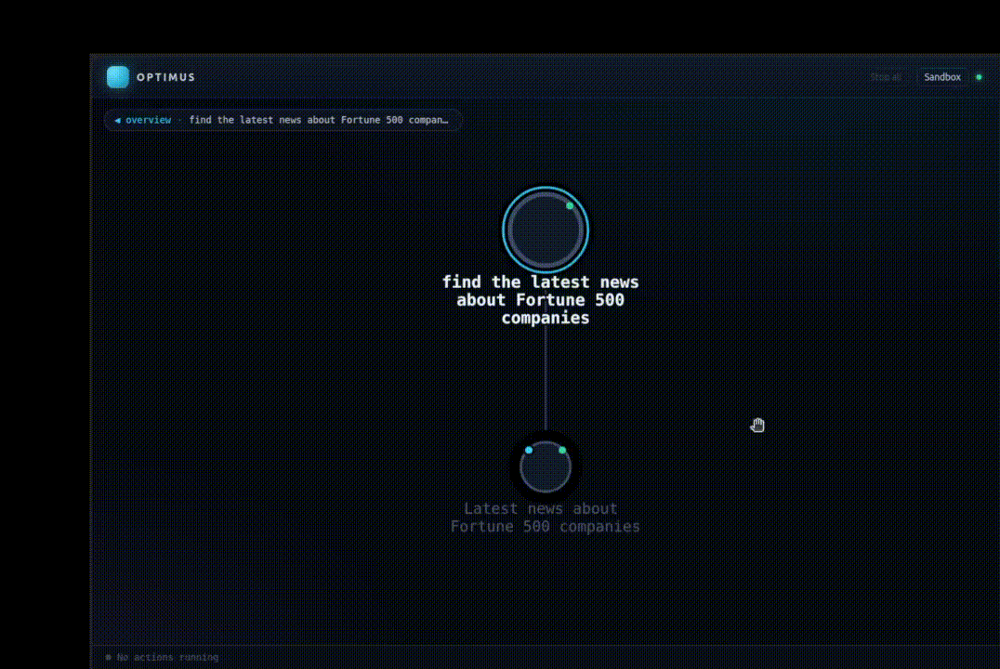
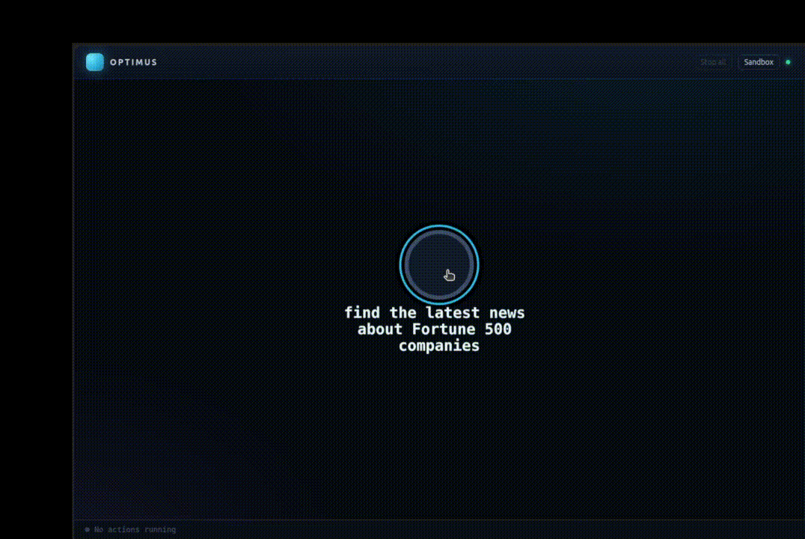
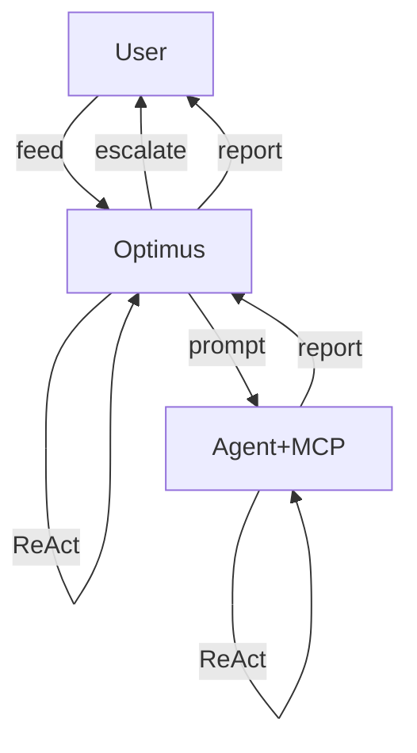

# Optimus - Agentic Engineering for All
Optimus is an easy to use, zero-code, AI agents platform that works with users to solve their problems. Deploy locally in your computer and start working. Some strong design choices were made to make Optimus an actual machine, meant to be owned and operated by accountable real users, with an option to repeat fully autonomous tasks in well established or low-risk scenarios.

It features:
1. **Dynamic multi-agent architectures** with minimal assumptions and a low technical barrier. Forget hard-coded sub-agents, esoteric skills and "trust me, bro" prompts. Users and LLMs co-design agent architectures from scratch as their problems are being solved.
2. A **powerful problem solving engine** to expand the horizon of tasks solvable by cheaper LLMs, based on [this research on context segmentation](https://arxiv.org/abs/2609.12839).
3. A **robust agent harness** with feedback to allow even the weakest agent-ready LLM to recover from and capitalize on small mistakes, shifting user priorities, and unexpected situations.
4. An **intuitive user interface** that allows drawing, testing, steering and connecting task nodes.

Optimus aims to be deployable in the cloud and on edge devices, with wide applications ranging from white-collar co-workers to industrial robots, given the right MCP tools.

Powered by [LLMs](https://github.com/ggml-org/llama.cpp) and [DSPy](https://github.com/stanfordnlp/dspy). Does not stand in the way of search and compute.

<!-- # QUICK OPERATIONS HERE -->
<table>
  <tr>
    <td align="center">
      
      <br>
      <b>Create</b>
      <br>
      Create nodes to invent new tasks
    </td>
    <td align="center">
      
      <br>
      <b>Consolidate</b>
      <br>
      Read node reports and tell it where to improve
    </td>
    <td align="center">
      
      <br>
      <b>Connect</b>
      <br>
      Build on previously established tasks
    </td>
  </tr>
</table>

# Installation
Optimus comes with a **Docker Compose** stack that deploys a **Gemma-4 E4B model on CPU** by default, an **agent sandbox** with terminal and browser tools, and the **Optimus backend and frontend app**. 8GB of RAM is enough for the entire default stack to run.

Alternatively, you can skip Docker and configure Optimus in your Python environment, but you must provide your own OpenAI compatible API and MCP server.

### With Docker
Spin up the entire local agentic stack ([llama.cpp](https://github.com/ggml-org/llama.cpp), [AIO agent sandbox](https://github.com/agent-infra/sandbox), optimus), or edit the env vars in the `optimus` service to point to a different OpenAI compatible provider, and MCP gateway.
```bash
THREADS=8 docker compose up -d optimus sandbox runner
```
Start working with Optimus at `http://127.0.0.1:8000`.

### Python only
Install Optimus:
```bash
# Requires Python > 3.12
python3 -m venv .venv
source .venv/bin/activate
python3 -m pip install -r requirements.txt
```
Point to your favorite (local) endpoints:
```bash
export OPENAI_API_BASE=http://127.0.0.1:8081/v1
export OPENAI_API_KEY=1234
export OPENAI_API_MODEL=openai/my/local/model
export MCP_GATEWAY=http://127.0.0.1:8080/mcp
```
Try out the web app:
```bash
python3 backend.py --file tasks.json --approval
```

# How the harness works
Optimus is a **ReAct loop spawning graphs of ReAct loops**. It splits the main task into sub-tasks, solves them, observes the results and decides if either new sub-tasks are due or the main task is complete. Each sub-task is tackled by a separate ReAct agent, carrying the benefits explained in [this paper](https://arxiv.org/abs/2609.12839). For the duration of the same main task, agents share their findings in a common `working memory`. This core engine is mostly invisible to the user, to both avoid getting in the way of the extraordinary search and compute capabilities of AI Agents, and to keep the user focused on its own problems.

An Optimus agent stops and asks for the user's intervention when either:
1. a **non-readonly action** is about to be performed;
2. it is lost and **unable to complete** its task;
3. it thinks the **main task is done**.

In each of these cases, users must provide feedback in human language to steer the agents towards the right path.

Each of the three cases above ensure that, respectively:
1. users are accountable for potentially destructive actions;
2. users can fill knowledge gaps that the agents are displaying;
3. users can amend, shift priorities, change their minds and follow up with new ideas.
> [!TIP]
> Point (2.) is especially relevant when working with weaker LLMs.

Every time the user provides any feedback, Optimus stores it in a list of `examples` for that task. When the same task is run again, the list will be consumed to refine its instructions and influence all subsequent ReAct loops.

Here is an overview of the engine:


## Tools
Keeping context size minimal makes AI Agents faster, cheaper and smarter. Since tool definitions and tool call chains are two of the major sources of context bloat in AI Agents, Optimus features:
- **context segmentation** so that, for example, an agent scrolling documentation in a browser only shares the final results of its research, instead of the entire trajectory, with a second agent writing code on a terminal;
- robust **dynamic tool discovery**, hiding any number of verbose and irrelevant tool descriptions behind a `list_tools`, `describe_tools` and `run_tools` triplet for all ReAct loops;
- in particular, `run_tools` accepts a list of tools, allowing agents to perform multiple actions within a single reasoning step.

## See it in action
### Gemma-4 E4B - cluster-wide K8s troubleshooting with small local models on CPU
### DeepSeek V4.1 Flash - Deep research with frontier models

## Future additions
- tool output scrolling
- visible context memory pressure before pivoting
<!-- - memory oblivion logic for `examples`; -->
- cronjobs;
- user sessions in backend and frontend
- openai compatible API as main optimus interface (this unlocks mobile apps and business integrations)
- chat gateways (telegram, slack, discord, teams, gmeet)
- better minimum viable MCP sandbox (browser, terminal, files folder and chat gateways), MVMS.
- decision models (DeAct?)
<!-- 
# TODO:
# - improve the visibility of reports inside the node. How about popping the report up when hovering over the node, while allowing to scroll it if it's long?
# - improve user experience in UI,
# - review and simplify and secure frontend,
# - desktop/mobile app
# - minimalistic input interface (less clicking, more typing). Single input box, greyed out when no situations or any task is awake (meaning the engine is busy doing something). Emergency button to stop all tasks and go full sleep.
# - try different inspiring visual flavors: network of neurons, galaxy of stars, ...

# - User manual: rule of thumb: approve anything that makes sense and seems related to the task and is not destructive. No need to deep dive into what the agent is doing, that's the point of having an agent
# - implement tool output scrolling, sort of mini-RLM

# 3. implement cron: repeat non-root tasks at scheduled intervals;
# 5. full TUI version of this, callable in a terminal (by providing the backend URL as argument);
# 6. allow reviewing QnA if anything changes
# 7. Vibe code a white collar MCP sandbox with file management, notes, email, calendar, logs in to google/microsoft suites, handles secrets and credentials via agent (it's local anyway)
# 8. backend multiplexing when two UIs are open and consume the same queue of tokens;
# 9. implement fzf-like search
# 10. make a truly air-gapped frontend (no CDN for js)
# 11. develop a minimum viable mcp sandbox with: browser, terminal and a fileshare folder (where human and optimus can share files)
 -->


# How Optimus came to be
Motivated by the possibility of realizing my childhood dream of having little thinking machines making lives easier and happier for humans, and not the other way around, I have been experimenting with SLMs on cheap hardware for more than three years. Optimus is the last iteration, after a long list of previously failed and dropped attempts to make local artificially intelligent agents useful.

## The intuition
Suppose your AI agent achieved the intended goal with no mistakes and no hiccups, then look just one step back. All your AGENT.md, MEMORY.md, skills, tool signatures, RAG knowledge, chat messages were mixed into a single, final prompt. That prompt got the job done, but your harness is now a bloated mess that binds you to expensive and ever scarier proprietary frontier model providers.

What if you could instead start from scratch, with minimal assumptions, decent hardware and an ok LLM, and rely on a continuous, evidence-driven prompt search algorithm, that learned directly from you and the environment on which it is supposed to be deployed, with no additional structural overhead or rigid assumptions on what the agentic architecture will look like? You would own the machine, the problems, the outcomes, and let automated search and compute do what it does best. Enter Optimus.

## Why it works
Instead of manually chasing outcomes, Optimus focuses on applying a scientific method to explore the prompts that might generate those outcomes, collaborating with the user on corner cases. Anything that the LLM can infer at runtime is left to be inferred at runtime.

## From Conversations to Prototyping
We are used to chatting with AI. On one side, conversations and prompt engineering with LLMs can become exhausting for humans when faced with complex tasks. The gap between what you want to say and how you should say it can get frustrating. On the other side, computers require linearly more RAM as conversations grow, and this can quickly become a dealbreaker when deploying locally.

Chatbots came first, but that's not what agents are about. Optimus replaces long conversations with a zero-code canvas, where machine accelerated prototyping of agentic architectures can be performed by anyone. Humans are called when Agents are lost, not the other way around. Humans are also required to approve dangerous actions, and provide tips when unsatisfied. This means that when you see Optimus humming for ~15 minutes before coming back to you, you should remember that it has probably just spared you tens of thousands of tokens of tedious conversations and manual engineering, and it's running privately on your laptop for free at a fraction of the available CPU cores.

Optimus differs from a typical conversational interface for a few reasons:
- effort is shifted away from the user and towards the LLM;
- conversational context size builds up more slowly thanks to context segmentation. LLM degradation due to context bloat is mitigated.
